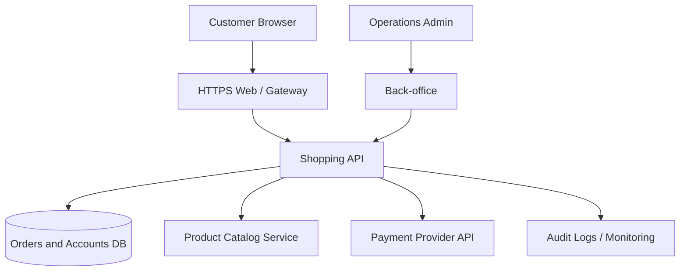

# กรณีศึกษากลาง: ร้านค้าออนไลน์จำลอง (Example Shop)

เพื่อไม่ให้ตัวอย่างในแต่ละบทเปลี่ยนบริบทจนติดตามยาก คู่มือจะใช้เว็บไซต์ร้านค้าออนไลน์ **Example Shop** ซึ่งเป็นระบบสมมติที่พบได้ทั่วไปในอุตสาหกรรม และสลับไปใช้ระบบ SaaS จองโรงแรม/โรงเรียนหรืออุปกรณ์ IoT เมื่อเหมาะสม

## ขอบเขตธุรกิจ

ผู้ใช้สมัครสมาชิก ค้นหาสินค้า ใส่ตะกร้า สั่งซื้อ และตรวจประวัติคำสั่งซื้อ ทีมงานมี Back-office สำหรับจัดการสต็อก/คืนสินค้า และระบบเชื่อม Payment Provider ภายนอกผ่าน API โดยไม่เก็บข้อมูลบัตรดิบไว้ในแอป

> แผนภาพนี้เป็น Logical Architecture สมมติ ไม่ใช่การอ้างว่าเว็บไซต์ E-commerce ใดมีโครงสร้างนี้จริง

## Asset Inventory ตั้งต้น

| Asset ID | Asset | Data | Exposure | Owner |
|---|---|---|---|---|
| APP-01 | Customer Web | Public Web Content | Internet-facing | Web Team |
| API-01 | Shopping API | Orders/Account Metadata | Gateway | API Team |
| DB-01 | Orders Database | Confidential | Private Zone | Data Team |
| APP-02 | Admin Back-office | Sensitive Operations | Restricted | Operations |
| EXT-01 | Payment Integration | API Tokens, Transaction Refs | Partner API | Payment Team |
| OPS-01 | Monitoring Service | Metrics / Audit Metadata | Admin Zone | SRE |

## เส้นทางการเรียน

- บทที่ 1–2: ระบุ Entry Points และ Attack Surface Types ของ Example Shop
- บทที่ 3: ประเมินความเสี่ยงกรณีลูกค้าเห็นออเดอร์ของคนอื่น
- บทที่ 4–5: ทำ Asset Inventory และ Discovery
- บทที่ 6: ระบุ Crown Jewel เช่น Customer Data และ Payment Credentials
- บทที่ 7: ทำ STRIDE ให้ Login, Checkout และ Admin API
- บทที่ 8–9: แก้และลด Exposure ที่ไม่จำเป็น
- บทที่ 10–11: Monitoring, Incident Response, AI Assistant และ Cryptographic Agility

## กฎสำคัญของกรณีศึกษา

ข้อมูลทุกชุดเป็น Synthetic Data ไม่มีลูกค้าจริงและไม่มี Credentials จริง เมื่อเปลี่ยนไปใช้ระบบ Production ต้องเพิ่มอนุมัติ Scope, Data Protection และ Validation ตามบริบท
